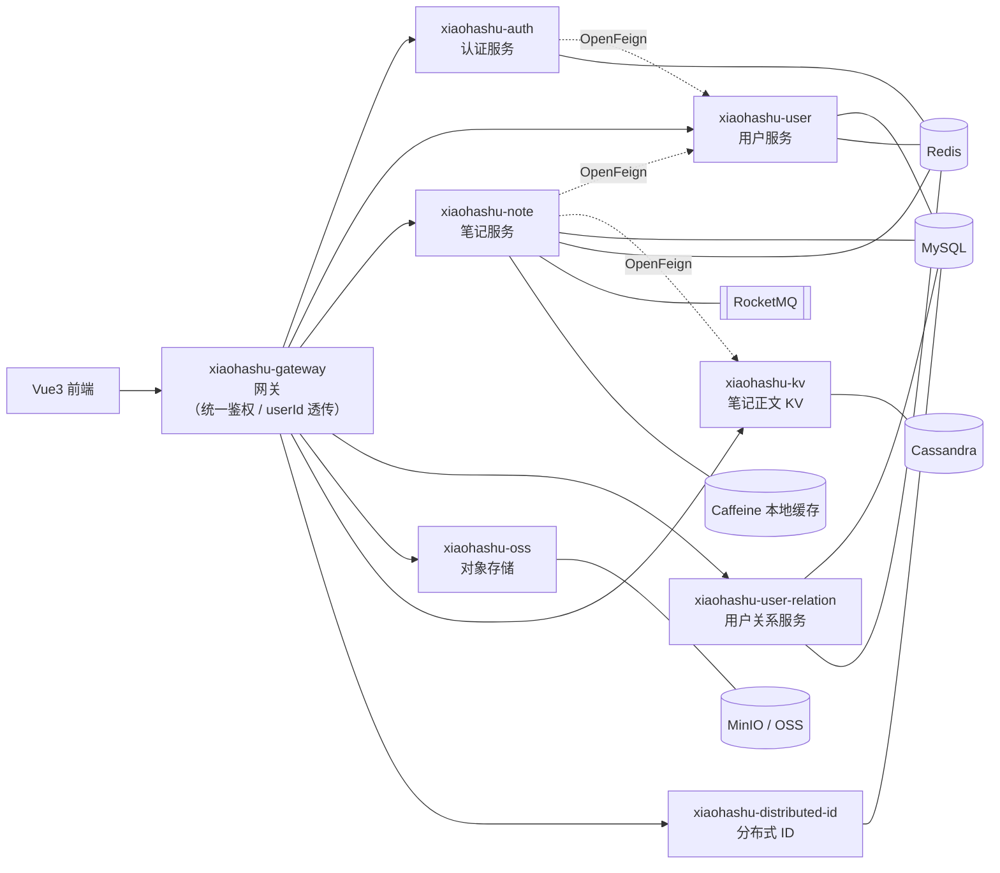

# 小哈书（xiaohashu）· 仿小红书微服务项目

> 基于 **Spring Cloud Alibaba** 的内容社区微服务，覆盖认证授权、网关、笔记发布、用户关系、对象存储、分布式 ID 等完整链路，是一份可写进简历的微服务实战项目。

<div align="center">


</div>

---

## 一、项目简介

小哈书是一个「仿小红书」的内容社区，采用 **Spring Boot 3 + Spring Cloud Alibaba** 微服务架构，后端按业务拆分为 8 个服务，通过 **Spring Cloud Gateway** 统一入口，**Nacos** 做服务注册与配置中心，**Sa-Token** 做认证授权，**Redis + Caffeine** 做多级缓存，**RocketMQ** 做跨实例缓存同步。

项目重点打磨了几个面试高频的技术点：**自定义 Starter 自动装配、网关 Sa-Token 上下文透传、OpenFeign 跨服务 ThreadLocal 透传、多级缓存治理（雪崩/穿透/击穿）、CompletableFuture 并发聚合下游、RocketMQ 广播 + 延时双删、Redis ZSet + Lua 原子操作**。

---

## 二、技术栈

### 后端

| 分类 | 技术 |
|---|---|
| 基础框架 | Spring Boot 3.0.2、Spring Cloud 2022.0.0、Spring Cloud Alibaba 2022.0.0.0 |
| JDK | 17 |
| 网关 | Spring Cloud Gateway（WebFlux 响应式） |
| 认证 | Sa-Token（JWT + Redis 持久化） |
| 服务调用 | OpenFeign |
| ORM | MyBatis-Plus |
| 数据库 | MySQL 8、Cassandra（笔记正文 KV） |
| 缓存 | Redis + Caffeine |
| 消息队列 | RocketMQ（广播模式 + 延时消息） |
| 服务治理 | Nacos（注册中心 + 配置中心） |
| 对象存储 | MinIO / 阿里云 OSS（策略模式） |
| 分布式 ID | 美团 Leaf（号段 + 雪花） |
| 连接池 | Druid |
| 压测 | JMeter |

### 前端（配套）

| 分类 | 技术 |
|---|---|
| 框架 | Vue 3.5 + Vite 6 + Vue Router 4 |
| 状态管理 | Pinia |
| UI 组件 | Ant Design Vue 4 |
| 样式 | Tailwind CSS 4 |
| HTTP | Axios |

---

## 三、架构设计



**核心链路说明**：

1. 前端所有请求 → 网关 → 按路径路由到对应服务；
2. 网关基于 Sa-Token 做统一登录鉴权，并把登录 `userId` 写入请求头透传到下游；
3. 笔记详情接口通过 `CompletableFuture` 并发聚合用户信息、正文 KV 等多个下游服务；
4. 笔记更新后通过 RocketMQ **广播** 同步各实例本地缓存，并 **延时双删** Redis 保证一致性。

---

## 四、功能清单

### 已实现 ✅

| 模块 | 功能 |
|---|---|
| 认证授权 | 手机号 + 密码 / 手机号 + 验证码登录、登出、强制下线、RBAC 角色权限、验证码发送 |
| 网关 | 统一路由转发、全局登录鉴权、userId 请求头透传、统一 401/403 JSON 异常 |
| 用户服务 | 注册、资料更新（含头像）、按手机号查询、按 ID 查询、密码更新（BCrypt 随机盐加密） |
| 笔记服务 | 发布（图文 / 视频）、详情、更新、删除（逻辑删除）、置顶、仅自己可见 |
| 频道与话题 | 频道管理、话题、频道-话题关联 |
| 用户关系 | 关注 / 取关、关注列表、粉丝列表（Redis ZSet + Lua 原子操作） |
| 对象存储 | 图片 / 文件上传（MinIO / 阿里云 OSS 策略模式） |
| KV 存储 | 笔记正文与元数据分离（Cassandra） |
| 分布式 ID | 美团 Leaf 号段 / 雪花（双 Buffer） |
| 多级缓存 | Redis + Caffeine 二级缓存，防缓存雪崩 / 穿透 / 击穿 |
| 消息队列 | RocketMQ 广播同步本地缓存 + 延时双删 |
| 自定义 Starter | 登录用户上下文、接口操作日志、Jackson 序列化、统一响应体（零配置接入） |

### 待实现 🚧

- [ ] 评论系统
- [ ] 点赞、收藏
- [ ] 通知系统
- [ ] Elasticsearch 全文搜索
- [ ] 分布式事务（Seata）
- [ ] 关注 / 推荐 Feed 流

---

## 五、模块结构

```
xiaohashu
├── xiaoha-framework                      # 框架基础（聚合模块，含 4 个 Starter）
│   ├── xiaoha-spring-boot-starter-biz-context      # 登录用户上下文（TransmittableThreadLocal）
│   ├── xiaoha-spring-boot-starter-biz-operationlog # 接口操作日志（AOP）
│   ├── xiaoha-spring-boot-starter-jackson          # Jackson 序列化（LocalDateTime 等）
│   └── xiaoha-common                                # 统一响应体 / 全局异常 / 工具
├── xiaohashu-gateway                     # 网关（Spring Cloud Gateway + Sa-Token）
├── xiaohashu-auth                        # 认证服务（登录 / 登出 / 验证码 / RBAC）
├── xiaohashu-user                        # 用户服务（用户信息 CRUD + 二级缓存）
├── xiaohashu-note                        # 笔记服务（发布 / 详情 / 更新 / 置顶 / 可见性）
├── xiaohashu-user-relation               # 用户关系服务（关注 / 粉丝）
├── xiaohashu-oss                         # 对象存储（MinIO / OSS 策略模式）
├── xiaohashu-kv                          # KV 存储（笔记正文，Cassandra）
└── xiaohashu-distributed-id-generator    # 分布式 ID（美团 Leaf）
```

---

## 六、技术亮点

1. **自定义 Spring Boot Starter 自动装配**：通过 `AutoConfiguration.imports` 实现零配置接入，业务侧一行 `LoginUserContextHolder.getUserId()` 即可拿到当前登录用户。
2. **网关 Sa-Token 上下文丢失解决**：Sa-Token 鉴权发生在 WebFilter，登录上下文无法传递到 GlobalFilter；通过在 `setAuth` 回调里把 userId 暂存到 `exchange.attributes` 解决。
3. **OpenFeign 跨服务 ThreadLocal 透传**：`TransmittableThreadLocal` 存值 + Feign `RequestInterceptor` 写请求头 + 下游 `HeaderUserId2ContextFilter` 还原，解决跨服务调用 userId 丢失。
4. **多级缓存治理**：Redis + Caffeine 二级缓存，空值缓存防穿透、互斥锁防击穿、随机过期时间防雪崩；JMeter 100 并发压测下接口从 128ms / 575ms 降到 1ms，0 错误。
5. **CompletableFuture 并发聚合**：笔记详情并发调用下游，缩短响应耗时。
6. **RocketMQ 广播 + 延时双删**：广播模式同步各实例本地缓存，事务提交后延时删除 Redis，保证多实例缓存一致性。
7. **Redis ZSet + Lua 原子操作**：关注 / 粉丝列表用 ZSet 存储（member = userId，score = 时间戳），Lua 脚本保证操作原子性。

---

## 七、快速开始

### 环境要求

- JDK 17
- Maven 3.8+
- MySQL 8
- Redis
- Nacos 2.x
- RocketMQ
- MinIO（或阿里云 OSS）
- Cassandra（KV 存储）
- Node.js 18+（前端）

### 启动步骤

1. **启动中间件**：MySQL、Redis、Nacos、RocketMQ、MinIO、Cassandra；
2. **配置**：各服务 `application-dev.yml` 中数据库 / Redis / 对象存储配置改为对应地址（敏感项用环境变量注入）；
3. **构建框架模块**：
   ```bash
   mvn -pl xiaoha-framework/xiaoha-common -am install -DskipTests
   ```
4. **启动后端服务**（建议顺序）：`xiaohashu-distributed-id-generator` → `xiaohashu-oss` / `xiaohashu-kv` → `xiaohashu-user` / `xiaohashu-note` / `xiaohashu-user-relation` → `xiaohashu-auth` → `xiaohashu-gateway`；
5. **启动前端**：
   ```bash
   cd xiaohashu-vue3
   npm install
   npm run dev
   ```

---

## 八、项目截图

> 待补充：运行后在此处放置登录、笔记流、笔记详情、个人主页等页面截图。

---

## 九、联系方式

- 作者：ayl04
- GitHub：https://github.com/ayl04
- 项目地址：https://github.com/ayl04/xiaohongshu